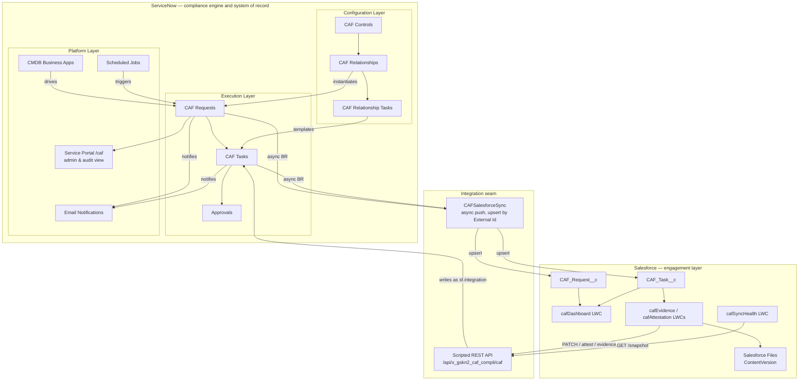
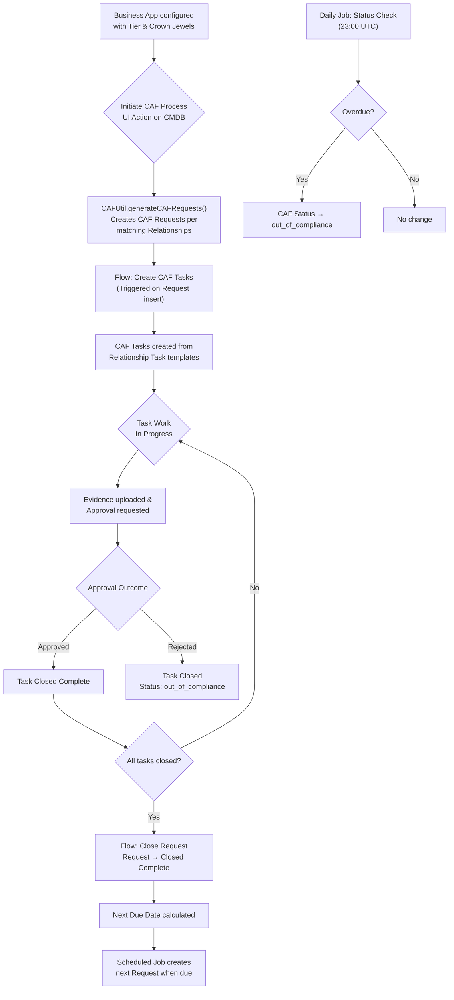
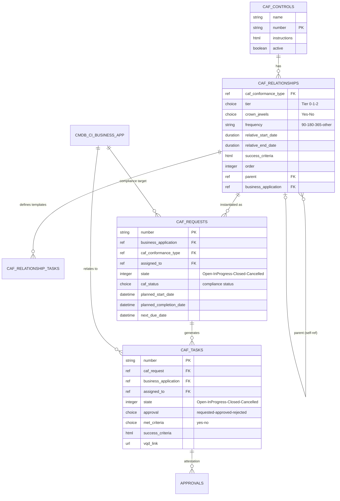
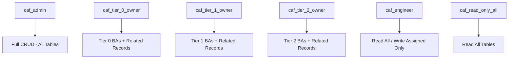
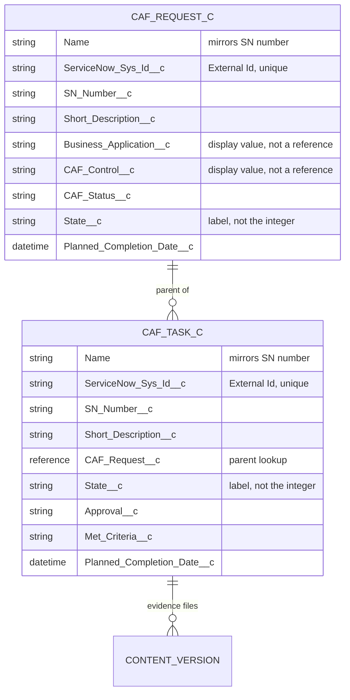
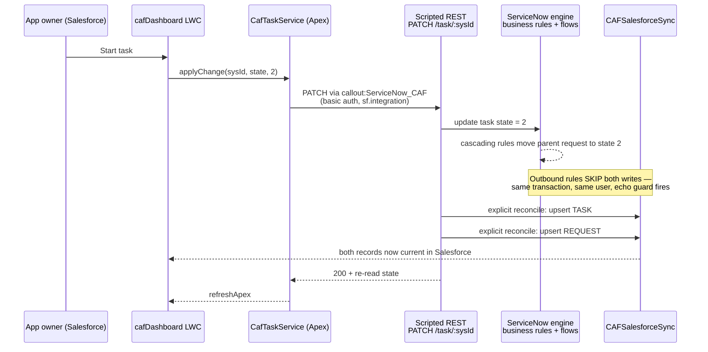

# 🏛️ CAF Compliance — Technical Design Document

> **Application:** CAF Compliance  
> **Scope:** `x_gskn2_caf_compli`  
> **Version:** 1.0.0  
> **Platforms:** ServiceNow (compliance engine, system of record) · Salesforce (engagement layer)  
> **Salesforce org:** `orgfarm-4938c7f768-dev-ed`, API v67.0  
> **Last Updated:** 2026-08-07

> **Document provenance.** Sections 1–10 were generated from ServiceNow instance
> metadata on 2026-06-18 and have not been re-verified in full since. The
> [Salesforce Integration](#salesforce-integration) section was written on
> 2026-08-07 and **every figure in it was read from the two live systems** at
> that date — the Scripted REST resource table from `sys_ws_operation`, the
> object schemas from the Salesforce describe, the properties from
> `sys_properties`. Where the two disagree, the newer section is the one that was
> checked.

---

## 📋 Table of Contents

- [Overview](#overview)
- [Architecture](#architecture)
- [Data Model](#data-model)
- [Business Logic](#business-logic)
- [Automation & Flows](#automation--flows)
- [Security Model](#security-model)
- [User Interface](#user-interface)
- [Notifications](#notifications)
- [Scheduled Jobs](#scheduled-jobs)
- [Application Navigation](#application-navigation)
- [**Salesforce Integration**](#salesforce-integration)
  - [The seam](#the-seam)
  - [Salesforce data model](#salesforce-data-model)
  - [Outbound: ServiceNow → Salesforce](#outbound-servicenow--salesforce)
  - [Inbound: Salesforce → ServiceNow](#inbound-salesforce--servicenow)
  - [The echo-loop guard and the explicit reconcile](#the-echo-loop-guard-and-the-explicit-reconcile)
  - [Salesforce components](#salesforce-components)
  - [Sync Health](#sync-health)
  - [Evidence and attestation](#evidence-and-attestation)
  - [Authentication](#authentication)
  - [Deviations and known limitations](#deviations-and-known-limitations)
- [Dependencies & Integrations](#dependencies--integrations)
- [Component Summary](#component-summary)
- [Key Design Decisions](#key-design-decisions)

---

## Overview

### Purpose

The **CAF Compliance** application ensures critical business applications remain compliant based on defined controls. It provides a structured framework for:

- Defining compliance controls (CAF Controls) with configurable frequencies
- Creating recurring compliance requests tied to business applications
- Tracking task-level evidence gathering and attestation
- Automating compliance lifecycle management with scheduled renewals
- Providing tiered visibility based on service categories (Tier 0/1/2)

### Key Capabilities

| Capability | Description |
|-----------|-------------|
| **Control Definition** | Define compliance controls with instructions and auto-numbering |
| **Relationship Mapping** | Map controls to service tiers and crown jewel classifications |
| **Automated Request Generation** | Auto-create compliance requests based on configurable frequency |
| **Task Decomposition** | Break requests into individual tasks with success criteria |
| **Approval Workflow** | Built-in attestation and approval process for evidence |
| **Compliance Monitoring** | Automated overdue detection and status escalation |
| **Tiered Access Control** | Role-based access by service tier (0/1/2) |
| **Recurring Compliance** | Automatic next-cycle creation based on relative date calculations |
| **Salesforce engagement layer** | App owners view compliance, upload evidence and attest from Salesforce, without a ServiceNow licence |
| **Bi-directional sync with drift detection** | Mirrored records, upsert-by-External-Id, and a Sync Health panel that reports disagreement between the two platforms |

### Two platforms, one product

The application spans **ServiceNow and Salesforce**. The split is not a
distribution of the data model but a division of responsibility:

| ServiceNow owns | Salesforce owns |
|---|---|
| Controls, relationships, task templates | Business-facing UI |
| Request and task records — **system of record** | App-owner portfolio view |
| Recurrence, `next_due_date`, renewal | Drill-in to request and task detail |
| Scheduled jobs, overdue detection | Evidence upload (Salesforce Files) |
| Approvals engine and attestation outcome | Attestation submission UI |
| Roles, ACLs, row-level security | The CAF dashboard as an LWC |

**The governing rule is that the state machine and system of record stay in
ServiceNow.** Recurrence maths, overdue detection, state transitions, approvals
and the security model are all state logic; splitting state across two platforms
produces two schedulers, two truths about whether a request is closed, and an
audit trail nobody trusts. **Salesforce holds a mirror, never a second opinion.**

Everything in [Salesforce Integration](#salesforce-integration) follows from that
rule. The AngularJS Service Portal at `/caf` is **not decommissioned** — it
remains the admin and audit view, and the LWC dashboard is its business-user
equivalent.

Three reasons for the split, in the order they were argued:

1. **Licensing.** Every app owner and delegate approver touching CAF today needs
   a ServiceNow fulfiller licence. In a Salesforce-centric organisation those
   people already hold Salesforce licences.
2. **Adoption.** The BRD lists low portal adoption as a risk. *"I'm not logging
   into ServiceNow for this"* disappears when the work surfaces where users
   already spend the day.
3. **Engine untouched.** Zero change to the 24 business rules, the two flows, the
   recurrence logic or the security model documented below. Low delivery risk.

### Application Metadata

| Property | Value |
|----------|-------|
| **Name** | CAF Compliance |
| **Scope** | `x_gskn2_caf_compli` |
| **Sys ID** | `7889b3de1bfca150a3d187b8e34bcbdf` |
| **Version** | 1.0.0 |
| **JS Level** | Helsinki ES5 — no `let`/`const`, arrow functions, template literals or ES6 `Array` methods in server scripts |
| **License Model** | None |

#### Salesforce org

| Property | Value |
|----------|-------|
| **Org** | `orgfarm-4938c7f768-dev-ed` (Developer Edition) |
| **API Version** | v67.0 (Summer '26) |
| **Apex API Version** | 67.0 across all classes and components |
| **Daily API Requests** | 15,000 — counted on requests *inbound* to Salesforce, so only the outbound push and dev tooling draw on it. One full end-to-end journey costs roughly 45 |
| **Storage** | 5 MB data, 20 MB files |

---

## Architecture

### High-Level Architecture



**Read the seam as one-directional for truth and bi-directional for traffic.**
Records only ever originate in ServiceNow. Salesforce sends *intentions* —
start this task, attest this outcome, attach this file — which ServiceNow
applies under its own rules before pushing the resulting state back.

### Process Flow



---

## Data Model

### Entity Relationship Diagram



---

### Table: CAF Controls

**System Name:** `x_gskn2_caf_compli_caf_conformance_type`  
**Label:** CAF Controls  
**Features:** Auto-number enabled, Not extendable

| Field | Label | Type | Max Length | Reference | Required | Description |
|-------|-------|------|-----------|-----------|----------|-------------|
| `name` | Name | String | 40 | — | No | Name of the compliance control |
| `number` | Number | String | 40 | — | No | Auto-generated control number |
| `instructions` | Instructions | HTML | 65000 | — | No | Detailed instructions for the control |
| `active` | Active | Boolean | 40 | — | No | Whether the control is currently in use |
| `sys_tags` | Tags | Related Tags | — | — | No | Categorization tags |

---

### Table: CAF Controls Relationships

**System Name:** `x_gskn2_caf_compli_caf_relationship`  
**Label:** CAF Controls Relationships  
**Features:** Not extendable, Requires `caf_admin` role

| Field | Label | Type | Max Length | Reference | Required | Description |
|-------|-------|------|-----------|-----------|----------|-------------|
| `caf_conformance_type` | CAF Control Name | Reference | — | `caf_conformance_type` | **Yes** | Link to the parent CAF Control |
| `tier` | Service Category | Choice | 40 | — | **Yes** | Service tier: Tier 0, Tier 1, Tier 2 |
| `crown_jewels` | Crown Jewels | Choice | 40 | — | **Yes** | Crown jewels classification: Yes/No |
| `frequency` | Frequency | String (Choice) | 40 | — | **Yes** | Recurrence in days: 90, 180, 365, other |
| `relative_start_date` | Relative Start Date | Duration | — | — | No | Days before due date to start |
| `relative_end_date` | Relative End Date | Duration | — | — | **Yes** | Days relative to end |
| `relative_creation` | Relative Creation | Duration | — | — | No | Days before due to create request |
| `success_criteria` | Success Criteria | HTML | 65000 | — | **Yes** | Criteria for successful completion |
| `order` | Order | Integer | 40 | — | **Yes** | Display/execution order |
| `parent` | Parent | Reference | — | `caf_relationship` | No | Self-referencing parent relationship |
| `business_application` | Business Application | Reference | — | `cmdb_ci_business_app` | No | Associated business application |
| `tasks_required` | Tasks Required | Simple Name Values | 4000 | — | No | Configurable task requirements |
| `active` | Active | Boolean | 40 | — | No | Whether this relationship is active |

---

### Table: CAF Relationship Tasks

**System Name:** `x_gskn2_caf_compli_caf_relationship_tasks`  
**Label:** CAF Relationship Tasks  
**Features:** Not extendable — serves as task templates

| Field | Label | Type | Max Length | Reference | Required | Description |
|-------|-------|------|-----------|-----------|----------|-------------|
| `caf_relationship` | CAF Relationship | Reference | — | `caf_relationship` | **Yes** | Parent relationship this task belongs to |
| `short_description` | Short Description | String | 160 | — | **Yes** | Brief task description template |
| `description` | Description | String | 4000 | — | No | Detailed task description template |
| `emergency_tier` | Emergency Tier | String (Choice) | 40 | — | No | Tier override: Tier 0, Tier 1, Tier 2 |
| `crown_jewels` | Crown Jewels | Choice | 40 | — | No | Crown jewels filter: Yes/No |
| `frequency` | Frequency | String (Choice) | 40 | — | No | Frequency override: 90/180/365/other |
| `relative_start_date` | Relative Start Date | Duration | — | — | No | Task-specific start offset |
| `relative_end_date` | Relative End Date | Duration | — | — | No | Task-specific end offset |
| `order` | Order | Integer | 40 | — | No | Task execution order |
| `active` | Active | Boolean | 40 | — | No | Whether this template is active |

---

### Table: CAF Request

**System Name:** `x_gskn2_caf_compli_caf_req`  
**Label:** CAF Request  
**Features:** Auto-number enabled, Extendable

| Field | Label | Type | Max Length | Reference | Required | Description |
|-------|-------|------|-----------|-----------|----------|-------------|
| `number` | Number | String | 40 | — | No | Auto-generated request number |
| `short_description` | Short Description | String | 160 | — | No | Auto-generated (read-only) from BA + date + control |
| `business_application` | Business Application | Reference | — | `cmdb_ci_business_app` | No | Target business application |
| `caf_conformance_type` | CAF Control Name | Reference | — | `caf_relationship` | **Yes** | The control relationship being assessed |
| `assigned_to` | Assigned To | Reference | — | `sys_user` | **Yes** | Primary assignee for the request |
| `managed_by` | Managed By | Reference | — | `sys_user` | No | Business application manager |
| `process_control_owner` | Business Owner | Reference | — | `sys_user` | No | Process/control owner |
| `state` | State | Integer (Choice) | — | — | No | 1=Open, 2=In Progress, 3=Closed Complete, -1=Cancelled |
| `caf_status` | CAF Status | Choice | 40 | — | No | in_compliance, approaching_due, out_of_compliance, archer_exception_approved |
| `planned_start_date` | Planned Start Date | Date/Time | — | — | **Yes** | When the compliance cycle starts |
| `planned_completion_date` | Planned Completion Date | Date/Time | — | — | **Yes** | Compliance deadline |
| `actual_start_date` | Actual Start Date | Date/Time | — | — | No | When work actually began |
| `actual_completion_date` | Actual Completion Date | Date/Time | — | — | No | When work was completed |
| `next_due_date` | Next Due Date | Date/Time | — | — | No | Calculated next compliance cycle date (read-only) |
| `priority` | Priority | Integer (Choice) | — | — | No | 1=Critical, 2=High, 3=Moderate, 4=Low |
| `description` | Description | String | 4000 | — | No | Additional details |
| `comments` | Additional Comments | Journal Input | — | — | No | Activity stream |
| `active` | Active | Boolean | 40 | — | No | Auto-set to false on close/cancel |
| `allow_all_controls` | Allow Any Control | Boolean | 40 | — | No | Override control filtering |
| `archer_exception_approved` | Archer Finding Approved | Boolean | 40 | — | No | Whether an Archer exception applies |
| `archer_finding_number` | Archer Finding Number | String | 100 | — | No | External Archer reference |
| `sys_class_name` | Class | Sys Class Name | — | — | No | Table hierarchy class |

---

### Table: CAF Task

**System Name:** `x_gskn2_caf_compli_caf_tsk`  
**Label:** CAF Task  
**Features:** Auto-number enabled, Extendable

| Field | Label | Type | Max Length | Reference | Required | Description |
|-------|-------|------|-----------|-----------|----------|-------------|
| `number` | Number | String | 40 | — | No | Auto-generated task number |
| `short_description` | Short Description | String | 160 | — | No | Task summary (read-only, from template) |
| `description` | Description | String | 4000 | — | **Yes** | Detailed task instructions |
| `caf_request` | CAF Request | Reference | — | `caf_req` | No | Parent compliance request |
| `business_application` | Business Application | Reference | — | `cmdb_ci_business_app` | No | Auto-populated from parent request |
| `assigned_to` | Assigned To | Reference | — | `sys_user` | No | Person responsible for this task |
| `state` | State | Integer (Choice) | — | — | No | 1=Open, 2=In Progress, 3=Closed Complete, -1=Cancelled |
| `approval` | Approval | Choice | 40 | — | No | requested, approved, rejected, cancelled (read-only) |
| `met_criteria` | Met Criteria | Choice | 40 | — | No | yes/no — mandatory on close if success_criteria exists |
| `success_criteria` | Success Criteria | HTML | 65000 | — | No | What evidence/outcome is required |
| `planned_start_date` | Planned Start Date | Date/Time | — | — | No | Expected start (read-only) |
| `planned_completion_date` | Planned Completion Date | Date/Time | — | — | No | Expected completion (read-only) |
| `actual_start_date` | Actual Start Date | Date/Time | — | — | No | Auto-set when state → In Progress |
| `actual_completion_date` | Actual Completion Date | Date/Time | — | — | No | Auto-set when state → Closed |
| `priority` | Priority | Integer (Choice) | — | — | No | 1=Critical, 2=High, 3=Moderate, 4=Low |
| `vqd_link` | VQD Link | URL | 1024 | — | No | Link to validation evidence |
| `vqd_link_2` | VQD Link 2 | URL | 1024 | — | No | Additional evidence link |
| `comments` | Additional Comments | Journal Input | — | — | No | Activity stream |
| `active` | Active | Boolean | 40 | — | No | Auto-set to false on close/cancel |

---

## Business Logic

### Business Rules (24 total)

#### On CAF Request (`caf_req`)

| Rule | When | Trigger | Active | Description |
|------|------|---------|--------|-------------|
| **CAF - Manage Active Flag** | Before | Update | ✅ | Sets `active=false` when state → Closed (3) or Cancelled (-1) |
| **CAF - Request Actual End and Next due** | Before | Update | ✅ | On close: sets `actual_completion_date` and calculates `next_due_date` from relative date config |
| **CAF - update BA on out of compliance** | After | Update | ✅ | When `caf_status` → `out_of_compliance`, updates Business App's `u_caf_compliance_status` |
| **HLN - set BA to pending update** | After | Insert | ✅ | If BA status is `compliant`/`compliant_approved_exc`, changes to `undergoing_update` |
| **CAF - Request cancelled process** | After | Update | ✅ | On cancellation: calls `CAFUtil.cancelTasksOfRequest()` to cancel all child tasks |
| **CAF - mark BA out of comp on creation** | After | Insert | ❌ | *(Inactive)* Sets BA to out_of_compliance if not initiated |
| **CAF - query BR - filter records** | Before | Query | ✅ | Row-level security: restricts visible records to user's own BA unless admin/tier owner roles |

#### On CAF Task (`caf_tsk`)

| Rule | When | Trigger | Active | Description |
|------|------|---------|--------|-------------|
| **set business app** | Before | Insert | ✅ | Copies `business_application` from parent CAF Request |
| **CAF - Manage Active Flag Task** | Before | Update | ✅ | Sets `active=false` on close/cancel; sets `approval='cancelled'` on cancellation |
| **CAF - set Actual Start date on task** | Before | Update | ✅ | Auto-sets `actual_start_date` when state → In Progress |
| **CAF - set Actual End date on task** | Before | Update | ✅ | Auto-sets `actual_completion_date` when state → Closed |
| **CAF - Task - prevent state change** | Before | Update | ✅ | Prevents jumping directly from Open to Closed (must transition through In Progress) |
| **CAF - success criteria not met** | Before | Update | ✅ | Handles approval outcomes: closes task and updates parent request compliance status |
| **CAF - Parent CAF control close validation** | Before | Update | ✅ | Prevents task closure if parent CAF control's request is still active |
| **CAF - attachment mandatory** | Before | Update | ❌ | *(Inactive)* Requires attachment before closing tasks without success criteria |
| **CAF - cancel approvals** | After | Update | ✅ | Cancels all approval records when task is cancelled |
| **CAF - set Actual Start date on REQ** | After | Update | ✅ | Sets `actual_start_date` and `state=2` on parent request when task starts |
| **CAF - Task - query BR - filter records** | Before | Query | ✅ | Row-level security with delegate approver inclusion |

#### On CAF Relationships (`caf_relationship`)

| Rule | When | Trigger | Active | Description |
|------|------|---------|--------|-------------|
| **CAF - uniqueness check** | Before | Insert/Update | ✅ | Prevents duplicate relationships (same tier + crown_jewels + control type combination) |

#### On External Tables

| Rule | Table | When | Active | Description |
|------|-------|------|--------|-------------|
| **CAF - Approval Task** | `sysapproval_approver` | After Insert/Update | ❌ | *(Inactive)* Sets actual_start_date and short_description on approval records |

---

### Script Includes (2)

#### `CAFUtil` — Core Utility Class

| Property | Value |
|----------|-------|
| **API Name** | `x_gskn2_caf_compli.CAFUtil` |
| **Client Callable** | No |
| **Access** | Public |

**Methods:**

| Method | Parameters | Returns | Description |
|--------|-----------|---------|-------------|
| `getAppCount()` | — | Integer | Returns count of business applications |
| `getCAFControls(current)` | GlideRecord | String | Reference qualifier for control filtering |
| `cancelActiveRequests(BusAppSysId)` | String (sys_id) | void | Cancels all active requests for a business app |
| `cancelTasksOfRequest(cafReqSysId)` | String (sys_id) | void | Cancels all tasks under a specific request |
| `generateCAFRequests(BusAppSysId)` | String (sys_id) | void | Creates CAF requests for all matching relationships |

---

#### `caf_short_desc` — GlideAjax Helper

| Property | Value |
|----------|-------|
| **API Name** | `x_gskn2_caf_compli.caf_short_desc` |
| **Client Callable** | Yes |
| **Access** | Package Private |

Builds the short description string from: Business Application name + DRP/planned date + CAF Control type name. Called from client scripts via GlideAjax.

---

### Client Scripts (7)

| Script | Table | Type | Active | Description |
|--------|-------|------|--------|-------------|
| **CAF Request - Process name** | `caf_req` | onChange | ✅ | Calls `caf_short_desc` via GlideAjax to auto-generate short description |
| **CAF Request On Load** | `caf_req` | onLoad | ✅ | Makes fields read-only based on state and user role |
| **CAF - pop details based on business app** | `caf_req` | onChange | ✅ | Auto-populates `managed_by`, `process_control_owner`, `assigned_to` from BA |
| **CAF Task On Load Logic** | `caf_tsk` | onLoad | ✅ | Hides cancelled state, controls field visibility and read-only state |
| **CAF - Pop relative start - frequency** | `caf_relationship` | onChange | ✅ | Calculates `relative_start_date` based on frequency value |
| **CAF - on submit validations** | `caf_relationship` | onSubmit | ❌ | *(Inactive)* Validates crown_jewels/tier combinations |
| **Validate URL** | `caf_tsk` | onChange | ❌ | *(Inactive)* Validates VQD link URL format |

---

### UI Policies (6)

| Policy | Table | Condition | Effect |
|--------|-------|-----------|--------|
| **Archer field** | `caf_req` | `archer_exception_approved = true` | Shows/hides Archer-related fields |
| **Relative start date based on Frequency** | `caf_relationship` | `frequency != 'other'` | Makes `relative_start_date` read-only |
| **CAF - Task - met criteria mandatory** | `caf_tsk` | `state = 3 AND success_criteria not empty` | Makes `met_criteria` mandatory |
| **CAF - success criteria visibility** | `caf_tsk` | `success_criteria is not empty` | Shows success criteria field |
| **CAF - things to do on closed complete** | `caf_tsk` | `state = 3` | Makes entire form read-only |
| **Archer logic** | `caf_tsk` | `caf_request.archer_exception_approved = true` | Handles Archer exception display |

---

## Automation & Flows

### Flow: CAF - Create CAF Tasks

| Property | Value |
|----------|-------|
| **Trigger** | Record Created on `caf_req` |
| **Run As** | User with `caf_admin` role |
| **Status** | Published |

**Steps:**
1. Triggered when a new CAF Request is inserted
2. Looks up all CAF Relationship Tasks matching the request's control relationship
3. Iterates through each relationship task template
4. Creates a CAF Task for each, populating fields from the template (short_description, description, success_criteria, planned dates)

---

### Flow: CAF - Close Request When All Tasks Close

| Property | Value |
|----------|-------|
| **Trigger** | Record Updated on `caf_tsk` |
| **Run As** | System |
| **Status** | Published |

**Steps:**
1. Triggered when any CAF Task is updated
2. Counts all open (active) tasks under the parent CAF Request
3. If zero open tasks remain → closes the CAF Request (state = 3)
4. Handles approval creation and transition logic

---

## Security Model

### Roles (6)

| Role | Suffix | Purpose | Access Level |
|------|--------|---------|--------------|
| `caf_admin` | Admin | Full application management | CRUD on all tables |
| `caf_engineer` | Engineer | Operational execution | Read all, write only assigned records |
| `caf_tier_0_owner` | Tier 0 Owner | Tier 0 service management | Full access to Tier 0 BAs and related data |
| `caf_tier_1_owner` | Tier 1 Owner | Tier 1 service management | Full access to Tier 1 BAs and related data |
| `caf_tier_2_owner` | Tier 2 Owner | Tier 2 service management | Full access to Tier 2 BAs and related data |
| `caf_read_only_all` | Read Only | Audit/reporting access | Read-only on all CAF tables |

### Role Hierarchy Diagram



### ACLs (48+)

#### Table-Level ACLs (Representative Sample)

| Table | Operation | Roles / Conditions |
|-------|-----------|------------------|
| `caf_req` | Read | Filtered by query business rule (own BA records unless admin/tier owner) |
| `caf_req` | Create | Tier 0 service category apps only |
| `caf_req` | Write | Tier-specific owners for active records only |
| `caf_tsk` | Read | All CAF engineers can read |
| `caf_tsk` | Create | General create access |
| `caf_tsk` | Write | Active records only; tier-based restrictions |
| `caf_relationship` | Read | `caf_admin`, `caf_engineer`, `itil` |
| `caf_conformance_type` | Read | `itil` users |

#### Field-Level ACLs (Representative Sample)

| Table.Field | Operation | Purpose |
|------------|-----------|---------|
| `caf_tsk.number` | Write | Protect auto-generated number |
| `caf_req.active` | Write | Protect system-managed field |
| `caf_req.state` | Write | State transitions controlled by system |

#### Row-Level Security (Query Business Rules)

- **CAF Requests:** Users see only records where they are `assigned_to`, `managed_by`, or `process_control_owner` — unless they hold `caf_admin`, `caf_tier_X_owner`, or `caf_read_only_all` roles
- **CAF Tasks:** Similar filtering plus includes delegate approvers who can see tasks pending their approval

---

## User Interface

### UI Actions (2)

| Action | Table | Type | Active | Condition | Description |
|--------|-------|------|--------|-----------|-------------|
| **Initiate CAF Process** | `cmdb_ci_business_app` | Form Button (Server) | ✅ | BA status = `not_initiated` | Calls `CAFUtil.generateCAFRequests()` and sets BA status to `out_of_compliance` |
| **Risk Assessment** | `caf_req` | Form Link (Client) | ❌ | — | *(Inactive)* Opens risk assessment in GlideOverlay dialog |

### Form Behavior Summary

| Form | Key Behaviors |
|------|--------------|
| **CAF Request** | Auto-populates short description, managed_by, assigned_to from BA; fields become read-only based on state; Archer fields shown conditionally |
| **CAF Task** | Hides cancelled state from dropdown; read-only on close; approval related list hidden conditionally; met_criteria mandatory on close with success criteria |
| **CAF Relationship** | Frequency auto-populates relative_start_date; uniqueness validation prevents duplicates |

---

## Notifications

### Email Notifications (8)

| # | Notification | Table | Trigger | Recipients |
|---|-------------|-------|---------|------------|
| 1 | **CAF New Request Created** | `caf_req` | Insert | BA Manager, Assigned To |
| 2 | **CAF New Request Created - Reminder** | `caf_req` | Event: `caf.req.creation.remi` | BA Manager, Assigned To |
| 3 | **CAF State Changed** | `caf_req` | Update (state/status change) | Assigned To, BA Manager |
| 4 | **CAF - Task State Changed** | `caf_tsk` | Update (state change) | Assigned To |
| 5 | **CAF - Task Assigned To Changed** | `caf_tsk` | Update (assigned_to change) | New Assigned To |
| 6 | **CAF - Approval Requested** | `sysapproval_approver` | Insert (source=caf_tsk) | Approver |
| 7 | **CAF Compliance Status** | `cmdb_ci_business_app` | Update (compliance status change) | BA Manager |
| 8 | **CAF Crown Jewels** | `cmdb_ci_business_app` | Update (crown_jewels=Yes) | BA Manager |

### Registered Events (2)

| Event | Table | Usage |
|-------|-------|-------|
| `x_gskn2_caf_compli.CAF_new_Request` | `caf_req` | Fired by scheduled job for new request notifications |
| `x_gskn2_caf_compli.caf.req.creation.remi` | `caf_req` | Fired by flow for creation reminder notifications |

---

## Scheduled Jobs

### CAF - Create New CAF Requests

| Property | Value |
|----------|-------|
| **Schedule** | Daily at 23:30 UTC |
| **Active** | ✅ Yes |

**Logic:**
1. Queries all Business Applications with Tier 0/1/2 in Production
2. For each BA, checks for closed CAF requests
3. Calculates next due date based on `relative_creation` duration
4. If current date ≥ calculated creation date → generates new CAF requests
5. Fires `CAF_new_Request` event for notifications

---

### CAF - Update CAF Request Status if Overdue

| Property | Value |
|----------|-------|
| **Schedule** | Daily at 23:00 UTC |
| **Active** | ✅ Yes |

**Logic:**
1. Queries all active CAF requests
2. Compares `planned_completion_date` against current date
3. If overdue → sets `caf_status` to `out_of_compliance`
4. Triggers downstream business rules and notifications

---

## Application Navigation

### Menu: CAF Compliance

**Visible to:** `itil`, `caf_admin`, `caf_read_only_all`, `caf_tier_0_owner`, `caf_tier_1_owner`, `caf_tier_2_owner`, `caf_engineer`

| Order | Module | Type | Target | Role Filter | Notes |
|-------|--------|------|--------|-------------|-------|
| 10 | CAF Requests | List | `caf_req` | — | Filtered to assigned/owned records |
| 20 | CAF Tasks | List | `caf_tsk` | — | Filtered to assigned/owned records |
| 30 | CAF Controls Relationship | List | `caf_relationship` | `caf_admin` | Admin-only configuration |
| 35 | CAF Controls | List | `caf_conformance_type` | `caf_admin` | Admin-only configuration |
| 40 | Critical Business Applications | List | `cmdb_ci_business_app` | — | View: business_applications |
| 50 | Portal ➚ | Direct URL | `/caf` | — | Opens Service Portal |
| 65 | Dashboard - Data Analytics | Direct | PA Dashboard | — | Performance Analytics |

---

## Salesforce Integration

> Verified against both live systems on 2026-08-07.

### The seam

Salesforce mirrors two of the five ServiceNow tables — **CAF Request** and
**CAF Task** — and nothing else. Controls, relationships and task templates are
configuration, they change rarely, and mirroring them would create a second
place to configure the product. The consequence is deliberate and shows up in
the UI: the ServiceNow grid draws its columns from `caf_conformance_type` where
`active=true`, while the Salesforce grid derives them from the request data it
holds, so **a control with no requests gets a column in ServiceNow and none in
Salesforce**. That is expected behaviour, not drift, and Sync Health will not
report it because no mirrored record disagrees.

| Property | Value |
|---|---|
| **Correlation key** | ServiceNow `sys_id`, stored in the External Id field `ServiceNow_Sys_Id__c` |
| **Write semantics** | Upsert by External Id — replay-safe, verified idempotent |
| **Reverse correlation** | **None.** No Salesforce Id is ever stored in ServiceNow |
| **Deletes** | Propagate in neither direction |

**No Salesforce Id is stored back in ServiceNow, by design.** The correlation is
one-directional, which is what makes a Salesforce org rebuild survivable: repoint
the sync and every record re-upserts into place. The cost is that a record
deleted on one side lives on as an orphan on the other, and that *updating* a
not-yet-deleted ServiceNow record will **recreate** its Salesforce twin — so a
cleanup performed in the wrong order silently undoes itself. Kill switch off,
ServiceNow side first, kill switch on after.

### Salesforce data model



#### Object: CAF_Request__c

| Field | Type | Length | Notes |
|---|---|---|---|
| `Name` | Text | 80 | Set to the ServiceNow number on every push |
| `ServiceNow_Sys_Id__c` | Text | 32 | **External Id, unique** — the correlation key |
| `SN_Number__c` | Text | 40 | `RCAF…`, the human-facing identifier |
| `Short_Description__c` | Text | 255 | Truncated at 255 by the sync |
| `Business_Application__c` | Text | 100 | **Display value**, not a reference — CMDB is not mirrored |
| `CAF_Control__c` | Text | 120 | Display value resolved through the relationship record |
| `CAF_Status__c` | Text | 40 | `in_compliance` / `approaching_due` / `out_of_compliance` / `archer_exception_approved` |
| `State__c` | Text | 40 | **Label**, not the integer — `Open` / `In Progress` / `Closed Complete` / `Cancelled` |
| `Planned_Completion_Date__c` | DateTime | — | ISO-converted by the sync |

#### Object: CAF_Task__c

| Field | Type | Length | Notes |
|---|---|---|---|
| `Name` | Text | 80 | Set to the ServiceNow number on every push |
| `ServiceNow_Sys_Id__c` | Text | 32 | **External Id, unique** |
| `SN_Number__c` | Text | 40 | `CAFT…` |
| `Short_Description__c` | Text | 255 | |
| `CAF_Request__c` | Lookup → `CAF_Request__c` | 18 | Parented by External Id, not by Salesforce Id |
| `State__c` | Text | 40 | **The only mirrored field editable on the page layout** — see below |
| `Approval__c` | Text | 40 | `requested` / `approved` / `rejected` |
| `Met_Criteria__c` | Text | 40 | `yes` / `no` |
| `Planned_Completion_Date__c` | DateTime | — | |

**State is mirrored as a label, not as the integer.** `CAFSalesforceSync` maps
`1 → Open`, `2 → In Progress`, `3 → Closed Complete`, `-1 → Cancelled`, and the
`/snapshot` resource applies the same mapping. If those two lists ever disagree,
Sync Health reports drift on every record — which is loud enough to notice
immediately, and is the reason the mapping lives in exactly two places.

**Every mirrored field is Readonly on the page layout except `State__c`**, which
is editable solely so the drift demonstration is possible without touching
ServiceNow. Note the layout trap: a field *absent* from the layout also shows a
lock icon and refuses inline edit, even where field-level security grants Edit
and the describe reports `updateable=true`. Deliberately Readonly and
accidentally absent look identical to a user.

### Outbound: ServiceNow → Salesforce

| Business Rule | Table | When | Order | Active |
|---|---|---|---|---|
| `CAF - Push Request to Salesforce` | `x_gskn2_caf_compli_caf_req` | `async_always` | 1000 | Yes |
| `CAF - Push Task to Salesforce` | `x_gskn2_caf_compli_caf_tsk` | `async_always` | 1000 | Yes |

Both call the **`CAFSalesforceSync`** script include, which builds the payload,
obtains an OAuth token and issues a `PATCH` to the Salesforce upsert endpoint
`/services/data/vXX.X/sobjects/<object>/ServiceNow_Sys_Id__c/<sys_id>`.

> **`async_always`, not `async`.** The choice *labelled* "async" in
> `sys_script.when` has the value `async_always`; plain `async` is the deprecated
> one. Running after commit is what keeps a Salesforce outage off the critical
> path of a compliance write.

**Pushes are fire-and-forget.** `_push()` logs a failure with `gs.error` and
returns. A Salesforce outage therefore cannot roll back the ServiceNow
transaction that triggered it — which is correct for a compliance record, and is
precisely why [Sync Health](#sync-health) exists: without it a failed push lives
only as a log line nobody reads, while the dashboard carries on showing a value
that is no longer true.

#### Configuration properties

Six system properties, all in the application scope:

| Property | Type | Purpose |
|---|---|---|
| `x_gskn2_caf_compli.sf.enabled` | boolean | **Master kill switch.** `false` stops every outbound call immediately |
| `x_gskn2_caf_compli.sf.instance_url` | string | Salesforce My Domain URL; serves both the token endpoint and the data API |
| `x_gskn2_caf_compli.sf.api_version` | string | Salesforce REST API version |
| `x_gskn2_caf_compli.sf.client_id` | string | Consumer Key of the connected app |
| `x_gskn2_caf_compli.sf.client_secret` | **`password2`** | Consumer Secret, **encrypted at rest** |
| `x_gskn2_caf_compli.sf.integration_user` | string | The user name Salesforce-originated writes arrive as; the echo-loop guard keys off it |

The kill switch does **not** queue. Changes made while it is `false` do not reach
Salesforce and stay stale until a re-sync.

### Inbound: Salesforce → ServiceNow

One Scripted REST API, **`CAF Integration`**, base URI
`/api/x_gskn2_caf_compli/caf`, six resources — all active, all requiring
authentication, none requiring ACL authorisation:

| Method | Path | Resource | Purpose |
|---|---|---|---|
| `PATCH` | `/task/{sysId}` | Update Task | Generic task update, six-field allow-list |
| `POST` | `/task/{sysId}/evidence` | Upload Evidence | Base64 in, `sys_attachment` out |
| `GET` | `/task/{sysId}/evidence` | List Evidence | What ServiceNow actually holds; read-only |
| `POST` | `/task/{sysId}/attest` | Attest Task | The evidence gate, then the outcome |
| `GET` | `/snapshot` | Sync Snapshot | Read-only comparison feed |
| `POST` | `/resync/{type}/{sysId}` | Resync Record | Re-push one record; modifies nothing in ServiceNow |

Authentication is HTTP basic as **`sf.integration`**, reached from Apex through
the `ServiceNow_CAF` named credential.

#### The write allow-list

```javascript
var WRITABLE = ['state', 'met_criteria', 'approval', 'comments', 'vqd_link', 'vqd_link_2'];
```

**Anything outside that list fails the whole call** — `HTTP 400`,
`Fields not writable from Salesforce: <field>`, and *none* of the request is
applied, including the fields that were writable. Applying the writable subset
silently would leave a caller believing it had set `met_criteria` when it had
not, which is worse than an error.

#### Status codes

| Code | Condition |
|---|---|
| `200` | Update or attestation applied |
| `201` | Evidence stored as a `sys_attachment` |
| `400` | Empty body; non-allow-listed field; invalid `outcome` or `met_criteria` |
| `404` | No CAF Task with that `sys_id` |
| `409` | Task not In Progress; task no longer active; outcome already recorded |
| `428` | **Evidence gate** — no `sys_attachment` on the task |

#### Response envelope

Scripted REST wraps whatever a resource returns in a `result` key. Parsing the
top level in Apex yields a one-key Map and a null for every field wanted, which
surfaces downstream as a null-dereference pointing at nothing useful.
`CafSyncHealth`, `CafEvidenceService` and `CafAttestationService` each unwrap it;
anything new must do the same.

### The echo-loop guard and the explicit reconcile

This is the part of the integration most likely to be broken by a well-meaning
simplification, and the failure is silent.

The outbound rules skip anything written by `sf.integration`, which stops a
Salesforce update bouncing straight back. **That alone strands derived changes.**
Cascading rules run in the same transaction and are attributed to the same user,
so they are skipped too — measured: a task moved to In Progress moved its parent
request in ServiceNow while Salesforce still read `Open`, with **no push logged
for either record**.

The fix is to reconcile explicitly at the end of each inbound resource: exactly
two upserts — the task and its parent request — triggered by the *request* rather
than by a record change, so no loop can form from it.



The log signature of a healthy round trip is one `[SF->CAF]` line followed by two
`[CAF->SF]` lines within about a second. **If a future change removes the
explicit push, nothing errors** — the task simply stops matching its mirror, and
only Sync Health notices.

> The guard keys off the *user name*. Run the inbound API as any other account
> and the guard silently does nothing, producing a loop that spends the API
> budget with no error anywhere.

### Salesforce components

#### Apex classes (5, all unmanaged)

| Class | Responsibility |
|---|---|
| `CafDashboardController` | Read model for the grid. Returns rows and lets the LWC pivot them, so no column contract is invented in Apex |
| `CafTaskService` | `getTasks` for the drill-in; `applyChange` for the inbound `PATCH` |
| `CafEvidenceService` | Salesforce Files in, both file lists out, push to ServiceNow |
| `CafAttestationService` | Outcome out, ServiceNow's verdict back |
| `CafSyncHealth` | Callout, compare, report; and `resync` |

> `number` is a **reserved identifier in Apex**, which rules it out as a variable
> or field name. `CafAttestationService` uses `taskNumber`.

#### Lightning Web Components (4)

| Component | Placement | Notes |
|---|---|---|
| `cafDashboard` | CAF Dashboard tab | Applications as rows, controls as **dynamic columns from the data**, colour-coded dots, drill-in to tasks |
| `cafSyncHealth` | Inside `cafDashboard`, above the grid | Status strip; runs on load; `Re-check now` and per-difference `Re-sync` |
| `cafEvidence` | Drill-in panel and `CAF_Task__c` record page | Both file lists side by side; `hide-upload` flag serves the read-only modes |
| `cafAttestation` | Drill-in panel and record page | Criteria yes/no, comments, Approve / Reject |

All four are API v67. `cafEvidence` and `cafAttestation` additionally carry the
`lightningCommunity__Page` target so they are droppable on an Experience Cloud
page — though no such site exists yet.

> A `targetConfig` for `lightningCommunity__Page` **cannot contain `<property>`
> tags**. Design properties belong under `lightningCommunity__Default`; the bare
> target is enough to make a component droppable.

#### Org furniture

| Item | Detail |
|---|---|
| **Tabs** | CAF Dashboard, CAF Requests, CAF Tasks |
| **List views** | `All`, with explicit `<columns>` on both objects |
| **Page layouts** | Carrying the custom fields, every mirrored field Readonly except `State__c` |
| **Permission set** | `CAF_Integration` — in source, and must be extended for any new field |
| **Named credential** | `ServiceNow_CAF` → `https://dev281754.service-now.com`, principal type Named User. **Created by hand, deliberately not in source** |

> **The Metadata API blind spot.** Anything created over the Metadata API needs
> four things the UI wizard does silently — field-level security, a page layout
> entry, a list view *with columns*, and a tab. Every one of them fails as an
> empty screen rather than an error, which is why they surfaced one at a time.
> All four are fixed and in source.

### Sync Health

Answers the question the rest of the integration could not: *are these two
systems still telling the same story?*

`CafSyncHealth.check()` pulls `GET /snapshot`, compares it against the mirrored
records, and reports differences. It is **not `cacheable`** — an Apex method that
makes a callout cannot be — which is also what makes `Re-check now` honest: it
really does go and look.

**Four drift types, each of which has actually occurred on this project:**

| # | Drift | Cause | Repairable by Re-sync? |
|---|---|---|---|
| 1 | Value differs | Someone edited the mirror, or the echo guard stranded a derived change | **Yes** |
| 2 | In ServiceNow, missing in Salesforce | A failed push | **Yes** |
| 3 | In Salesforce, missing in ServiceNow | A record deleted in ServiceNow, or an orphan | **No** — repair only ever flows ServiceNow → Salesforce |
| 4 | Salesforce simply stale | Changes made with the kill switch off | **Yes** |

Two design invariants worth preserving:

- **Detection is automatic; repair never is.** `Re-sync` is a button beside a
  difference someone is looking at. Unattended repair can turn a Salesforce
  problem into a ServiceNow one.
- **Blank equals null.** ServiceNow returns null for an empty field and
  Salesforce may hold either. Treating them as different would report drift on
  every record with an empty `approval`, which is most of them.

`Re-sync` modifies **nothing** in ServiceNow. A mirror that disagrees is stale by
definition, so the system of record is never edited to match it.

### Evidence and attestation

Gathering evidence and judging it are **separate buttons and separate panels,
because they are done by separate people.** *Upload evidence* opens `cafEvidence`
alone; *Attest* opens it **read-only** beside `cafAttestation`, since an approver
has to see the evidence and must not be adding to it. The same component serves
both through the `hide-upload` flag, which a closed task also sets.

Row actions by task state:

| State | Actions |
|---|---|
| Open | Start, Upload evidence |
| In Progress | Upload evidence, Attest |
| Closed | View evidence only |

#### Two copies of every file, on purpose

Salesforce keeps the `ContentVersion`, which makes preview, download and the
standard Files related list work with no round trip. ServiceNow keeps a
`sys_attachment`, which is the copy an auditor is entitled to and **the only one
the attestation gate counts**. They are deliberately not reconciled — unlike a
mirrored field there is no value to disagree about — and `cafEvidence` shows both
lists side by side so a failed push is *visible rather than inferred*. A count
mismatch raises a warning in the panel.

**Ceiling: 2 MB per file**, enforced in both `CafEvidenceService` and the
ServiceNow resource (`MAX_BYTES = 2097152`). Apex holds the Blob and its base64
expansion in the same 6 MB heap and caps a callout body at 6 MB. Files push one
per Apex transaction, so the ceiling is a property of the **largest single file**,
not of how many were dropped at once.

> Apex cannot call out after DML in the same transaction. Uploading a file and
> pushing it are therefore two transactions — free through the LWC, because
> `lightning-file-upload` finishes before the push is invoked, but fatal to a
> single anonymous-Apex script that tries both.

#### The attestation engine already existed

The business rule **`CAF - success criteria not met`** (active, before update,
order 2100, filter `approvalVALCHANGES^active=true`) *is* the attestation
transition: `approved` closes the task and sets the parent request's `caf_status`
to `in_compliance`; `rejected` closes it and sets `out_of_compliance`. The attest
endpoint writes three fields and lets that rule do all of it. **The transition is
not reimplemented in the endpoint** — there would then be two of them, and the
`/caf` portal only ever runs one.

Two things the design above implies that the instance does not have:

- **`approval='requested'` is the default on every task**, not a
  submitted-for-approval state. There is no "submit for attestation" step to
  model; the act is `requested → approved | rejected`.
- **Approval routing is aspirational.** `CAF - Approval Task` is inactive and
  notification 6 *CAF - Approval Requested* therefore never fires.

#### Where the evidence gate lives, and why not in the business rule

`CAF - attachment mandatory for def tasks` implements exactly the same check and
is **deliberately left inactive**. Activating it would change closure behaviour
for the `/caf` portal and for admins, and pre-existing tasks have no attachment,
so every portal close would start failing. The gate is enforced in the attest
endpoint instead, where it binds every caller of that endpoint and nobody else.

**The asymmetry is intended and should be stated rather than discovered:** an
evidence-free task can still be closed through the ServiceNow portal; the same
task cannot be attested from Salesforce.

### Authentication

| Direction | Mechanism |
|---|---|
| **Outbound** ServiceNow → Salesforce | OAuth 2.0 **Client Credentials**, requested inline by `CAFSalesforceSync` from `sf.instance_url`, using `sf.client_id` and the encrypted `sf.client_secret` |
| **Inbound** Salesforce → ServiceNow | HTTP basic as `sf.integration`, through the `ServiceNow_CAF` named credential |

Two constraints on the named credential:

- **The name is load-bearing.** Apex references `callout:ServiceNow_CAF`; a
  rename breaks every callout in the integration.
- **It is created by hand and not in source, deliberately.** Salesforce will not
  deploy a named credential without a password, and that password must not sit
  in a client-facing directory. If the org is rebuilt, recreate it with that
  exact name.

### Deviations and known limitations

#### Deviations from the original design

| # | Deviation | Rationale |
|---|---|---|
| 1 | **Client Credentials rather than JWT bearer** | ServiceNow's `jwt_provider` table has no fields for `iss` / `sub` / `aud`, which Salesforce requires, so JWT needs a custom JWT API Script. Client Credentials was one policy change on the connected app. **JWT remains the better production answer** |
| 2 | **No Application Registry entity** | `CAFSalesforceSync` requests its own token inline, keeping every moving part in one script plus six system properties |
| 3 | **No Salesforce Id stored in ServiceNow** | One-directional correlation; makes an org rebuild survivable |
| 4 | **Row-level security deferred** | POC scope. The query business rules are not exercised across the seam |

#### Known limitations

| # | Limitation | Consequence |
|---|---|---|
| 1 | **No Experience Cloud site** | The components carry the target but there is nowhere to place them, so the licensing argument for the split is not yet realised end to end. Verify the org's Experience licence count before building on it |
| 2 | **No named approver** | Attestation uses the `approval` field alone, so whoever presses the button in Salesforce is the approver and the audit trail records only `sf.integration`. **For a compliance product this is the weakest point in the evidence chain** |
| 3 | **No Platform Events** | Every inbound call is synchronous. A ServiceNow outage surfaces as a failed action in the LWC — nothing is queued and nothing retries. Salesforce's own record is left unchanged, so the two sides stay consistent |
| 4 | **Sync Health has no schedule** | It runs when someone opens the dashboard or presses Re-check. A nightly comparison that emails or posts on drift is the obvious next step |
| 5 | **No Apex test coverage** on `CafSyncHealth`, `CafEvidenceService` or `CafAttestationService` | Acceptable in a Developer Edition org; **a hard blocker for production**, since Salesforce requires 75% org-wide coverage to deploy |
| 6 | **Compliance roll-up is computed twice, from different sources** | `cafDashboard` computes its own roll-up from the mirrored `CAF_Status__c` values and never reads `cmdb_ci_business_app.u_caf_compliance_status`. Where that field is wrong, the two surfaces **visibly disagree about identical data**, and Sync Health correctly reports "in sync" throughout because no mirrored record differs. Fix belongs in the ServiceNow business rule, not in the mirror |

---

## Dependencies & Integrations

| System | Integration Point | Direction | Description |
|--------|------------------|-----------|-------------|
| **CMDB** | `cmdb_ci_business_app` | Read/Write | Reads BA metadata (tier, crown jewels, owners); writes compliance status |
| **Approval Engine** | `sysapproval_approver` | Write | Creates approval records for task attestation |
| **Archer (External)** | Exception reference | Reference | Stores Archer finding numbers for approved exceptions |
| **Service Portal** | `/caf` | UI | Admin and audit compliance portal |
| **Performance Analytics** | Dashboard | Read | Compliance reporting and analytics |
| **Salesforce** | `CAFSalesforceSync` → REST upsert | Outbound | Async push of CAF Requests and Tasks, upsert by External Id |
| **Salesforce** | Scripted REST API `caf`, 6 resources | Inbound | Task updates, evidence, attestation, snapshot and re-sync, as `sf.integration` |
| **Salesforce Files** | `ContentVersion` | Bi-directional | Evidence held on both sides; ServiceNow's copy is the one the gate counts |

---

## Component Summary

### ServiceNow

| Category | Total | Active | Inactive |
|----------|-------|--------|----------|
| **Tables** | 5 | 5 | 0 |
| **Business Rules** | 24 | 20 | 4 |
| **Script Includes** | 2 | 2 | 0 |
| **Flows** | 2 | 2 | 0 |
| **Roles** | 6 | 6 | 0 |
| **ACLs** | 48+ | — | — |
| **Client Scripts** | 7 | 5 | 2 |
| **UI Actions** | 2 | 1 | 1 |
| **UI Policies** | 6 | 6 | 0 |
| **Scheduled Jobs** | 2 | 2 | 0 |
| **Email Notifications** | 8 | 8 | 0 |
| **Events** | 2 | 2 | 0 |
| **Modules** | 7 | 7 | 0 |
| **Application Menus** | 1 | 1 | 0 |
| **UI Pages** | 0 | — | — |
| **Scripted REST APIs** | 1 | 1 | 0 |
| **Scripted REST Resources** | 6 | 6 | 0 |
| **System Properties** (`sf.*`) | 6 | 6 | 0 |

*The two Salesforce push business rules and the `CAFSalesforceSync` script
include are counted in the Business Rules and Script Includes rows above.*

### Salesforce

| Category | Total | Notes |
|----------|-------|-------|
| **Custom Objects** | 2 | `CAF_Request__c`, `CAF_Task__c` |
| **Custom Fields** | 17 | 8 on Request, 9 on Task; 2 are External Ids |
| **Apex Classes** | 5 | All unmanaged; **0 test classes** |
| **Lightning Web Components** | 4 | All API v67 |
| **Page Layouts** | 2 | Every mirrored field Readonly except `State__c` |
| **List Views** | 2 | `All`, with explicit columns |
| **Tabs** | 3 | CAF Dashboard, CAF Requests, CAF Tasks |
| **Permission Sets** | 1 | `CAF_Integration` |
| **Named Credentials** | 1 | `ServiceNow_CAF` — by hand, not in source |
| **Apex Test Coverage** | **0%** | Blocking for production; see limitation 5 |

---

## Key Design Decisions

### Compliance engine (ServiceNow)

| Decision | Rationale |
|----------|-----------|
| **Separate Relationship Tasks table** | Reusable task templates instantiated per compliance cycle without duplicating configuration |
| **Relative date durations** | Flexible scheduling — controls can have different lead times and frequencies without hardcoding |
| **Query business rules for row-level security** | Users only see compliance data for their own business applications, enforced at platform level |
| **Tiered role model** | Aligns with organizational structure where different teams own different service categories |
| **Auto-number on Requests and Tasks** | Unique, human-readable identifiers for tracking and communication |
| **Self-referencing parent on Relationships** | Supports hierarchical control structures for complex compliance frameworks |
| **Archer exception support** | Acknowledges that some compliance gaps have approved exceptions from risk management |
| **Extendable Request and Task tables** | Allows future specialization of request/task types without schema migration |

### Integration (ServiceNow ↔ Salesforce)

| Decision | Rationale |
|----------|-----------|
| **State machine stays in ServiceNow** | The single decision everything else follows from. Splitting state across two platforms produces two schedulers, two truths about whether a request is closed, and an audit trail nobody trusts |
| **Only Requests and Tasks are mirrored** | Controls, relationships and task templates are configuration. Mirroring them would create a second place to configure the product |
| **Upsert by External Id on the ServiceNow `sys_id`** | Makes replay-on-failure safe, and makes a Salesforce org rebuild survivable — repoint the sync and every record re-upserts into place |
| **No Salesforce Id stored in ServiceNow** | Keeps the correlation one-directional. The cost is orphans on delete, which is the cheaper problem |
| **Async, fire-and-forget push** | A Salesforce outage must never roll back a compliance write. The cost is a failure visible only in a log, which is what Sync Health answers |
| **Echo-loop guard *plus* an explicit two-upsert reconcile** | The guard alone strands derived changes, because cascading rules run in the same transaction as the same user. The reconcile is triggered by the request rather than by a record change, so no loop can form. **Do not simplify this away — its failure is silent** |
| **Allow-list refuses the whole call** | A caller that believes it set a field and did not is worse than an error |
| **Detection automatic, repair never** | Unattended repair can turn a Salesforce problem into a ServiceNow one |
| **Repair only flows ServiceNow → Salesforce** | A mirror that disagrees is stale by definition |
| **Evidence stored on both sides, unreconciled** | Salesforce's copy serves preview and download; ServiceNow's is the auditor's copy and the only one the gate counts. There is no value to disagree about |
| **Evidence gate in the endpoint, not the business rule** | Activating the rule would change closure behaviour for the portal and for admins, and every pre-existing task has no attachment |
| **Attestation reuses the existing business rule** | Reimplementing the transition in the endpoint would create two of them, and the `/caf` portal only ever runs one |
| **Blank equals null in the comparison** | Otherwise drift is reported on every record with an empty `approval`, which is most of them |
| **Columns derived from data on both grids** | Adding a control needs no code change on either side. The accepted cost is that the two grids legitimately disagree about their column set |

---

*Sections 1–10 generated from ServiceNow instance metadata — scope
`x_gskn2_caf_compli` v1.0.0, 2026-06-18.*
*[Salesforce Integration](#salesforce-integration) and the revised architecture,
dependency, component and design-decision sections written 2026-08-07 and
verified against both live systems on that date.*