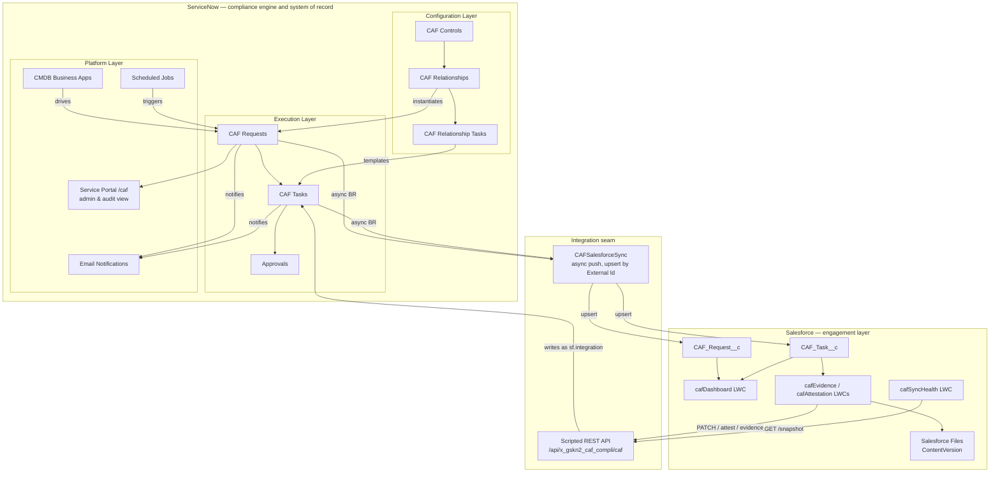
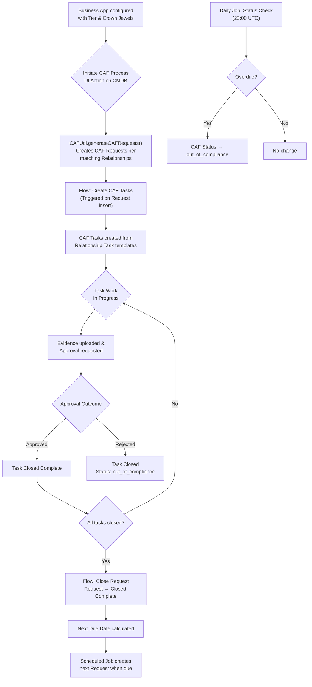

# 🏛️ CAF Compliance — Technical Design Document

> **Application:** CAF Compliance  
> **Scope:** `x_gskn2_caf_compli`  
> **Version:** 1.0.0  
> **Platforms:** ServiceNow (compliance engine, system of record) · Salesforce (engagement layer)  
> **Salesforce org:** `orgfarm-4938c7f768-dev-ed`, API v67.0  
> **Last Updated:** 2026-08-07

> **Document provenance.** Sections 1–10 were generated from ServiceNow instance
> metadata on 2026-06-18 and have not been re-verified in full since. The
> [Salesforce Integration](#salesforce-integration) section was written on
> 2026-08-07 and **every figure in it was read from the two live systems** at
> that date — the Scripted REST resource table from `sys_ws_operation`, the
> object schemas from the Salesforce describe, the properties from
> `sys_properties`. Where the two disagree, the newer section is the one that was
> checked.

---

## 📋 Table of Contents

- [Overview](#overview)
- [Architecture](#architecture)
- [Data Model](#data-model)
- [Business Logic](#business-logic)
- [Automation & Flows](#automation--flows)
- [Security Model](#security-model)
- [User Interface](#user-interface)
- [Notifications](#notifications)
- [Scheduled Jobs](#scheduled-jobs)
- [Application Navigation](#application-navigation)
- [**Salesforce Integration**](#salesforce-integration)
  - [The seam](#the-seam)
  - [Salesforce data model](#salesforce-data-model)
  - [Outbound: ServiceNow → Salesforce](#outbound-servicenow--salesforce)
  - [Inbound: Salesforce → ServiceNow](#inbound-salesforce--servicenow)
  - [The echo-loop guard and the explicit reconcile](#the-echo-loop-guard-and-the-explicit-reconcile)
  - [Salesforce components](#salesforce-components)
  - [Sync Health](#sync-health)
  - [Evidence and attestation](#evidence-and-attestation)
  - [Authentication](#authentication)
  - [Deviations and known limitations](#deviations-and-known-limitations)
- [Dependencies & Integrations](#dependencies--integrations)
- [Component Summary](#component-summary)
- [Key Design Decisions](#key-design-decisions)

---

## Overview

### Purpose

The **CAF Compliance** application ensures critical business applications remain compliant based on defined controls. It provides a structured framework for:

- Defining compliance controls (CAF Controls) with configurable frequencies
- Creating recurring compliance requests tied to business applications
- Tracking task-level evidence gathering and attestation
- Automating compliance lifecycle management with scheduled renewals
- Providing tiered visibility based on service categories (Tier 0/1/2)

### Key Capabilities

| Capability | Description |
|-----------|-------------|
| **Control Definition** | Define compliance controls with instructions and auto-numbering |
| **Relationship Mapping** | Map controls to service tiers and crown jewel classifications |
| **Automated Request Generation** | Auto-create compliance requests based on configurable frequency |
| **Task Decomposition** | Break requests into individual tasks with success criteria |
| **Approval Workflow** | Built-in attestation and approval process for evidence |
| **Compliance Monitoring** | Automated overdue detection and status escalation |
| **Tiered Access Control** | Role-based access by service tier (0/1/2) |
| **Recurring Compliance** | Automatic next-cycle creation based on relative date calculations |
| **Salesforce engagement layer** | App owners view compliance, upload evidence and attest from Salesforce, without a ServiceNow licence |
| **Bi-directional sync with drift detection** | Mirrored records, upsert-by-External-Id, and a Sync Health panel that reports disagreement between the two platforms |

### Two platforms, one product

The application spans **ServiceNow and Salesforce**. The split is not a
distribution of the data model but a division of responsibility:

| ServiceNow owns | Salesforce owns |
|---|---|
| Controls, relationships, task templates | Business-facing UI |
| Request and task records — **system of record** | App-owner portfolio view |
| Recurrence, `next_due_date`, renewal | Drill-in to request and task detail |
| Scheduled jobs, overdue detection | Evidence upload (Salesforce Files) |
| Approvals engine and attestation outcome | Attestation submission UI |
| Roles, ACLs, row-level security | The CAF dashboard as an LWC |

**The governing rule is that the state machine and system of record stay in
ServiceNow.** Recurrence maths, overdue detection, state transitions, approvals
and the security model are all state logic; splitting state across two platforms
produces two schedulers, two truths about whether a request is closed, and an
audit trail nobody trusts. **Salesforce holds a mirror, never a second opinion.**

Everything in [Salesforce Integration](#salesforce-integration) follows from that
rule. The AngularJS Service Portal at `/caf` is **not decommissioned** — it
remains the admin and audit view, and the LWC dashboard is its business-user
equivalent.

Three reasons for the split, in the order they were argued:

1. **Licensing.** Every app owner and delegate approver touching CAF today needs
   a ServiceNow fulfiller licence. In a Salesforce-centric organisation those
   people already hold Salesforce licences.
2. **Adoption.** The BRD lists low portal adoption as a risk. *"I'm not logging
   into ServiceNow for this"* disappears when the work surfaces where users
   already spend the day.
3. **Engine untouched.** Zero change to the 24 business rules, the two flows, the
   recurrence logic or the security model documented below. Low delivery risk.

### Application Metadata

| Property | Value |
|----------|-------|
| **Name** | CAF Compliance |
| **Scope** | `x_gskn2_caf_compli` |
| **Sys ID** | `7889b3de1bfca150a3d187b8e34bcbdf` |
| **Version** | 1.0.0 |
| **JS Level** | Helsinki ES5 — no `let`/`const`, arrow functions, template literals or ES6 `Array` methods in server scripts |
| **License Model** | None |

#### Salesforce org

| Property | Value |
|----------|-------|
| **Org** | `orgfarm-4938c7f768-dev-ed` (Developer Edition) |
| **API Version** | v67.0 (Summer '26) |
| **Apex API Version** | 67.0 across all classes and components |
| **Daily API Requests** | 15,000 — counted on requests *inbound* to Salesforce, so only the outbound push and dev tooling draw on it. One full end-to-end journey costs roughly 45 |
| **Storage** | 5 MB data, 20 MB files |

---

## Architecture

### High-Level Architecture

**Read the seam as one-directional for truth and bi-directional for traffic.**
Records only ever originate in ServiceNow. Salesforce sends *intentions* —
start this task, attest this outcome, attach this file — which ServiceNow
applies under its own rules before pushing the resulting state back.

### Process Flow

---

