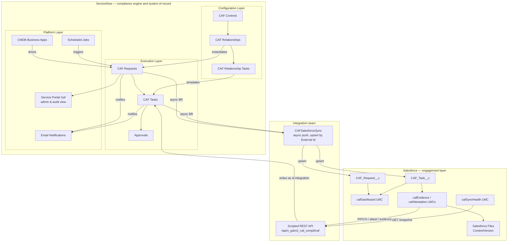
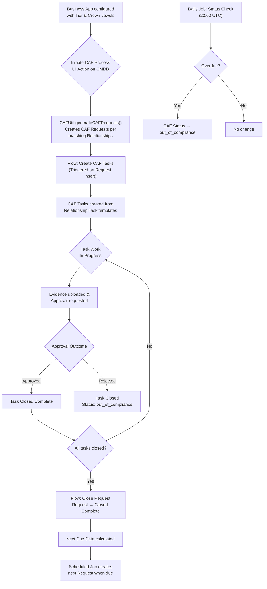
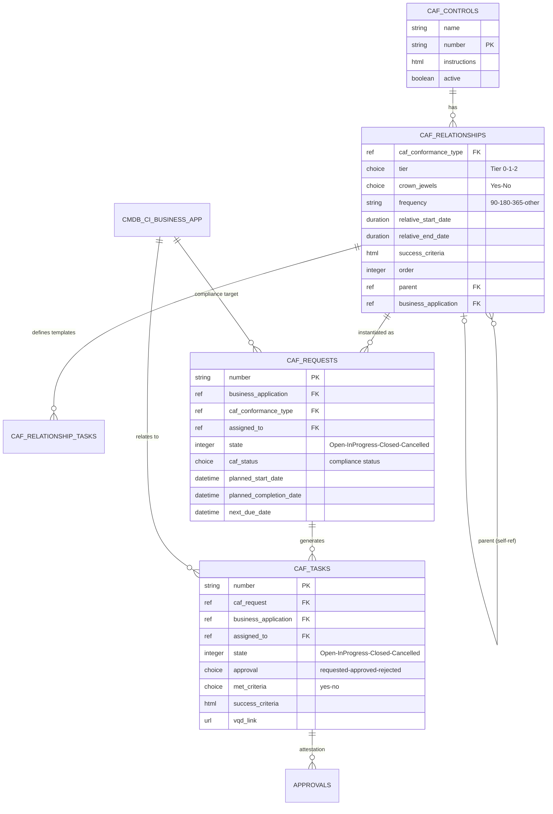
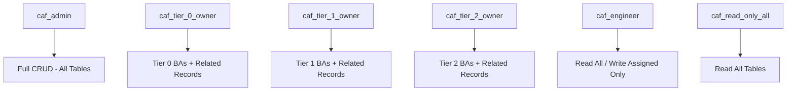

# 🏛️ CAF Compliance — Technical Design Document

> **Application:** CAF Compliance  
> **Scope:** `x_gskn2_caf_compli`  
> **Version:** 1.0.0  
> **Platforms:** ServiceNow (compliance engine, system of record) · Salesforce (engagement layer)  
> **Salesforce org:** `orgfarm-4938c7f768-dev-ed`, API v67.0  
> **Last Updated:** 2026-08-07

> **Document provenance.** Sections 1–10 were generated from ServiceNow instance
> metadata on 2026-06-18 and have not been re-verified in full since. The
> [Salesforce Integration](#salesforce-integration) section was written on
> 2026-08-07 and **every figure in it was read from the two live systems** at
> that date — the Scripted REST resource table from `sys_ws_operation`, the
> object schemas from the Salesforce describe, the properties from
> `sys_properties`. Where the two disagree, the newer section is the one that was
> checked.

---

## 📋 Table of Contents

- [Overview](#overview)
- [Architecture](#architecture)
- [Data Model](#data-model)
- [Business Logic](#business-logic)
- [Automation & Flows](#automation--flows)
- [Security Model](#security-model)
- [User Interface](#user-interface)
- [Notifications](#notifications)
- [Scheduled Jobs](#scheduled-jobs)
- [Application Navigation](#application-navigation)
- [**Salesforce Integration**](#salesforce-integration)
  - [The seam](#the-seam)
  - [Salesforce data model](#salesforce-data-model)
  - [Outbound: ServiceNow → Salesforce](#outbound-servicenow--salesforce)
  - [Inbound: Salesforce → ServiceNow](#inbound-salesforce--servicenow)
  - [The echo-loop guard and the explicit reconcile](#the-echo-loop-guard-and-the-explicit-reconcile)
  - [Salesforce components](#salesforce-components)
  - [Sync Health](#sync-health)
  - [Evidence and attestation](#evidence-and-attestation)
  - [Authentication](#authentication)
  - [Deviations and known limitations](#deviations-and-known-limitations)
- [Dependencies & Integrations](#dependencies--integrations)
- [Component Summary](#component-summary)
- [Key Design Decisions](#key-design-decisions)

---

## Overview

### Purpose

The **CAF Compliance** application ensures critical business applications remain compliant based on defined controls. It provides a structured framework for:

- Defining compliance controls (CAF Controls) with configurable frequencies
- Creating recurring compliance requests tied to business applications
- Tracking task-level evidence gathering and attestation
- Automating compliance lifecycle management with scheduled renewals
- Providing tiered visibility based on service categories (Tier 0/1/2)

### Key Capabilities

| Capability | Description |
|-----------|-------------|
| **Control Definition** | Define compliance controls with instructions and auto-numbering |
| **Relationship Mapping** | Map controls to service tiers and crown jewel classifications |
| **Automated Request Generation** | Auto-create compliance requests based on configurable frequency |
| **Task Decomposition** | Break requests into individual tasks with success criteria |
| **Approval Workflow** | Built-in attestation and approval process for evidence |
| **Compliance Monitoring** | Automated overdue detection and status escalation |
| **Tiered Access Control** | Role-based access by service tier (0/1/2) |
| **Recurring Compliance** | Automatic next-cycle creation based on relative date calculations |
| **Salesforce engagement layer** | App owners view compliance, upload evidence and attest from Salesforce, without a ServiceNow licence |
| **Bi-directional sync with drift detection** | Mirrored records, upsert-by-External-Id, and a Sync Health panel that reports disagreement between the two platforms |

### Two platforms, one product

The application spans **ServiceNow and Salesforce**. The split is not a
distribution of the data model but a division of responsibility:

| ServiceNow owns | Salesforce owns |
|---|---|
| Controls, relationships, task templates | Business-facing UI |
| Request and task records — **system of record** | App-owner portfolio view |
| Recurrence, `next_due_date`, renewal | Drill-in to request and task detail |
| Scheduled jobs, overdue detection | Evidence upload (Salesforce Files) |
| Approvals engine and attestation outcome | Attestation submission UI |
| Roles, ACLs, row-level security | The CAF dashboard as an LWC |

**The governing rule is that the state machine and system of record stay in
ServiceNow.** Recurrence maths, overdue detection, state transitions, approvals
and the security model are all state logic; splitting state across two platforms
produces two schedulers, two truths about whether a request is closed, and an
audit trail nobody trusts. **Salesforce holds a mirror, never a second opinion.**

Everything in [Salesforce Integration](#salesforce-integration) follows from that
rule. The AngularJS Service Portal at `/caf` is **not decommissioned** — it
remains the admin and audit view, and the LWC dashboard is its business-user
equivalent.

Three reasons for the split, in the order they were argued:

1. **Licensing.** Every app owner and delegate approver touching CAF today needs
   a ServiceNow fulfiller licence. In a Salesforce-centric organisation those
   people already hold Salesforce licences.
2. **Adoption.** The BRD lists low portal adoption as a risk. *"I'm not logging
   into ServiceNow for this"* disappears when the work surfaces where users
   already spend the day.
3. **Engine untouched.** Zero change to the 24 business rules, the two flows, the
   recurrence logic or the security model documented below. Low delivery risk.

### Application Metadata

| Property | Value |
|----------|-------|
| **Name** | CAF Compliance |
| **Scope** | `x_gskn2_caf_compli` |
| **Sys ID** | `7889b3de1bfca150a3d187b8e34bcbdf` |
| **Version** | 1.0.0 |
| **JS Level** | Helsinki ES5 — no `let`/`const`, arrow functions, template literals or ES6 `Array` methods in server scripts |
| **License Model** | None |

#### Salesforce org

| Property | Value |
|----------|-------|
| **Org** | `orgfarm-4938c7f768-dev-ed` (Developer Edition) |
| **API Version** | v67.0 (Summer '26) |
| **Apex API Version** | 67.0 across all classes and components |
| **Daily API Requests** | 15,000 — counted on requests *inbound* to Salesforce, so only the outbound push and dev tooling draw on it. One full end-to-end journey costs roughly 45 |
| **Storage** | 5 MB data, 20 MB files |

---

## Architecture

### High-Level Architecture

**Read the seam as one-directional for truth and bi-directional for traffic.**
Records only ever originate in ServiceNow. Salesforce sends *intentions* —
start this task, attest this outcome, attach this file — which ServiceNow
applies under its own rules before pushing the resulting state back.

### Process Flow

---

## Data Model

### Entity Relationship Diagram

---

### Table: CAF Controls

**System Name:** `x_gskn2_caf_compli_caf_conformance_type`  
**Label:** CAF Controls  
**Features:** Auto-number enabled, Not extendable

| Field | Label | Type | Max Length | Reference | Required | Description |
|-------|-------|------|-----------|-----------|----------|-------------|
| `name` | Name | String | 40 | — | No | Name of the compliance control |
| `number` | Number | String | 40 | — | No | Auto-generated control number |
| `instructions` | Instructions | HTML | 65000 | — | No | Detailed instructions for the control |
| `active` | Active | Boolean | 40 | — | No | Whether the control is currently in use |
| `sys_tags` | Tags | Related Tags | — | — | No | Categorization tags |

---

### Table: CAF Controls Relationships

**System Name:** `x_gskn2_caf_compli_caf_relationship`  
**Label:** CAF Controls Relationships  
**Features:** Not extendable, Requires `caf_admin` role

| Field | Label | Type | Max Length | Reference | Required | Description |
|-------|-------|------|-----------|-----------|----------|-------------|
| `caf_conformance_type` | CAF Control Name | Reference | — | `caf_conformance_type` | **Yes** | Link to the parent CAF Control |
| `tier` | Service Category | Choice | 40 | — | **Yes** | Service tier: Tier 0, Tier 1, Tier 2 |
| `crown_jewels` | Crown Jewels | Choice | 40 | — | **Yes** | Crown jewels classification: Yes/No |
| `frequency` | Frequency | String (Choice) | 40 | — | **Yes** | Recurrence in days: 90, 180, 365, other |
| `relative_start_date` | Relative Start Date | Duration | — | — | No | Days before due date to start |
| `relative_end_date` | Relative End Date | Duration | — | — | **Yes** | Days relative to end |
| `relative_creation` | Relative Creation | Duration | — | — | No | Days before due to create request |
| `success_criteria` | Success Criteria | HTML | 65000 | — | **Yes** | Criteria for successful completion |
| `order` | Order | Integer | 40 | — | **Yes** | Display/execution order |
| `parent` | Parent | Reference | — | `caf_relationship` | No | Self-referencing parent relationship |
| `business_application` | Business Application | Reference | — | `cmdb_ci_business_app` | No | Associated business application |
| `tasks_required` | Tasks Required | Simple Name Values | 4000 | — | No | Configurable task requirements |
| `active` | Active | Boolean | 40 | — | No | Whether this relationship is active |

---

### Table: CAF Relationship Tasks

**System Name:** `x_gskn2_caf_compli_caf_relationship_tasks`  
**Label:** CAF Relationship Tasks  
**Features:** Not extendable — serves as task templates

| Field | Label | Type | Max Length | Reference | Required | Description |
|-------|-------|------|-----------|-----------|----------|-------------|
| `caf_relationship` | CAF Relationship | Reference | — | `caf_relationship` | **Yes** | Parent relationship this task belongs to |
| `short_description` | Short Description | String | 160 | — | **Yes** | Brief task description template |
| `description` | Description | String | 4000 | — | No | Detailed task description template |
| `emergency_tier` | Emergency Tier | String (Choice) | 40 | — | No | Tier override: Tier 0, Tier 1, Tier 2 |
| `crown_jewels` | Crown Jewels | Choice | 40 | — | No | Crown jewels filter: Yes/No |
| `frequency` | Frequency | String (Choice) | 40 | — | No | Frequency override: 90/180/365/other |
| `relative_start_date` | Relative Start Date | Duration | — | — | No | Task-specific start offset |
| `relative_end_date` | Relative End Date | Duration | — | — | No | Task-specific end offset |
| `order` | Order | Integer | 40 | — | No | Task execution order |
| `active` | Active | Boolean | 40 | — | No | Whether this template is active |

---

### Table: CAF Request

**System Name:** `x_gskn2_caf_compli_caf_req`  
**Label:** CAF Request  
**Features:** Auto-number enabled, Extendable

| Field | Label | Type | Max Length | Reference | Required | Description |
|-------|-------|------|-----------|-----------|----------|-------------|
| `number` | Number | String | 40 | — | No | Auto-generated request number |
| `short_description` | Short Description | String | 160 | — | No | Auto-generated (read-only) from BA + date + control |
| `business_application` | Business Application | Reference | — | `cmdb_ci_business_app` | No | Target business application |
| `caf_conformance_type` | CAF Control Name | Reference | — | `caf_relationship` | **Yes** | The control relationship being assessed |
| `assigned_to` | Assigned To | Reference | — | `sys_user` | **Yes** | Primary assignee for the request |
| `managed_by` | Managed By | Reference | — | `sys_user` | No | Business application manager |
| `process_control_owner` | Business Owner | Reference | — | `sys_user` | No | Process/control owner |
| `state` | State | Integer (Choice) | — | — | No | 1=Open, 2=In Progress, 3=Closed Complete, -1=Cancelled |
| `caf_status` | CAF Status | Choice | 40 | — | No | in_compliance, approaching_due, out_of_compliance, archer_exception_approved |
| `planned_start_date` | Planned Start Date | Date/Time | — | — | **Yes** | When the compliance cycle starts |
| `planned_completion_date` | Planned Completion Date | Date/Time | — | — | **Yes** | Compliance deadline |
| `actual_start_date` | Actual Start Date | Date/Time | — | — | No | When work actually began |
| `actual_completion_date` | Actual Completion Date | Date/Time | — | — | No | When work was completed |
| `next_due_date` | Next Due Date | Date/Time | — | — | No | Calculated next compliance cycle date (read-only) |
| `priority` | Priority | Integer (Choice) | — | — | No | 1=Critical, 2=High, 3=Moderate, 4=Low |
| `description` | Description | String | 4000 | — | No | Additional details |
| `comments` | Additional Comments | Journal Input | — | — | No | Activity stream |
| `active` | Active | Boolean | 40 | — | No | Auto-set to false on close/cancel |
| `allow_all_controls` | Allow Any Control | Boolean | 40 | — | No | Override control filtering |
| `archer_exception_approved` | Archer Finding Approved | Boolean | 40 | — | No | Whether an Archer exception applies |
| `archer_finding_number` | Archer Finding Number | String | 100 | — | No | External Archer reference |
| `sys_class_name` | Class | Sys Class Name | — | — | No | Table hierarchy class |

---

### Table: CAF Task

**System Name:** `x_gskn2_caf_compli_caf_tsk`  
**Label:** CAF Task  
**Features:** Auto-number enabled, Extendable

| Field | Label | Type | Max Length | Reference | Required | Description |
|-------|-------|------|-----------|-----------|----------|-------------|
| `number` | Number | String | 40 | — | No | Auto-generated task number |
| `short_description` | Short Description | String | 160 | — | No | Task summary (read-only, from template) |
| `description` | Description | String | 4000 | — | **Yes** | Detailed task instructions |
| `caf_request` | CAF Request | Reference | — | `caf_req` | No | Parent compliance request |
| `business_application` | Business Application | Reference | — | `cmdb_ci_business_app` | No | Auto-populated from parent request |
| `assigned_to` | Assigned To | Reference | — | `sys_user` | No | Person responsible for this task |
| `state` | State | Integer (Choice) | — | — | No | 1=Open, 2=In Progress, 3=Closed Complete, -1=Cancelled |
| `approval` | Approval | Choice | 40 | — | No | requested, approved, rejected, cancelled (read-only) |
| `met_criteria` | Met Criteria | Choice | 40 | — | No | yes/no — mandatory on close if success_criteria exists |
| `success_criteria` | Success Criteria | HTML | 65000 | — | No | What evidence/outcome is required |
| `planned_start_date` | Planned Start Date | Date/Time | — | — | No | Expected start (read-only) |
| `planned_completion_date` | Planned Completion Date | Date/Time | — | — | No | Expected completion (read-only) |
| `actual_start_date` | Actual Start Date | Date/Time | — | — | No | Auto-set when state → In Progress |
| `actual_completion_date` | Actual Completion Date | Date/Time | — | — | No | Auto-set when state → Closed |
| `priority` | Priority | Integer (Choice) | — | — | No | 1=Critical, 2=High, 3=Moderate, 4=Low |
| `vqd_link` | VQD Link | URL | 1024 | — | No | Link to validation evidence |
| `vqd_link_2` | VQD Link 2 | URL | 1024 | — | No | Additional evidence link |
| `comments` | Additional Comments | Journal Input | — | — | No | Activity stream |
| `active` | Active | Boolean | 40 | — | No | Auto-set to false on close/cancel |

---

## Business Logic

### Business Rules (24 total)

#### On CAF Request (`caf_req`)

| Rule | When | Trigger | Active | Description |
|------|------|---------|--------|-------------|
| **CAF - Manage Active Flag** | Before | Update | ✅ | Sets `active=false` when state → Closed (3) or Cancelled (-1) |
| **CAF - Request Actual End and Next due** | Before | Update | ✅ | On close: sets `actual_completion_date` and calculates `next_due_date` from relative date config |
| **CAF - update BA on out of compliance** | After | Update | ✅ | When `caf_status` → `out_of_compliance`, updates Business App's `u_caf_compliance_status` |
| **HLN - set BA to pending update** | After | Insert | ✅ | If BA status is `compliant`/`compliant_approved_exc`, changes to `undergoing_update` |
| **CAF - Request cancelled process** | After | Update | ✅ | On cancellation: calls `CAFUtil.cancelTasksOfRequest()` to cancel all child tasks |
| **CAF - mark BA out of comp on creation** | After | Insert | ❌ | *(Inactive)* Sets BA to out_of_compliance if not initiated |
| **CAF - query BR - filter records** | Before | Query | ✅ | Row-level security: restricts visible records to user's own BA unless admin/tier owner roles |

#### On CAF Task (`caf_tsk`)

| Rule | When | Trigger | Active | Description |
|------|------|---------|--------|-------------|
| **set business app** | Before | Insert | ✅ | Copies `business_application` from parent CAF Request |
| **CAF - Manage Active Flag Task** | Before | Update | ✅ | Sets `active=false` on close/cancel; sets `approval='cancelled'` on cancellation |
| **CAF - set Actual Start date on task** | Before | Update | ✅ | Auto-sets `actual_start_date` when state → In Progress |
| **CAF - set Actual End date on task** | Before | Update | ✅ | Auto-sets `actual_completion_date` when state → Closed |
| **CAF - Task - prevent state change** | Before | Update | ✅ | Prevents jumping directly from Open to Closed (must transition through In Progress) |
| **CAF - success criteria not met** | Before | Update | ✅ | Handles approval outcomes: closes task and updates parent request compliance status |
| **CAF - Parent CAF control close validation** | Before | Update | ✅ | Prevents task closure if parent CAF control's request is still active |
| **CAF - attachment mandatory** | Before | Update | ❌ | *(Inactive)* Requires attachment before closing tasks without success criteria |
| **CAF - cancel approvals** | After | Update | ✅ | Cancels all approval records when task is cancelled |
| **CAF - set Actual Start date on REQ** | After | Update | ✅ | Sets `actual_start_date` and `state=2` on parent request when task starts |
| **CAF - Task - query BR - filter records** | Before | Query | ✅ | Row-level security with delegate approver inclusion |

#### On CAF Relationships (`caf_relationship`)

| Rule | When | Trigger | Active | Description |
|------|------|---------|--------|-------------|
| **CAF - uniqueness check** | Before | Insert/Update | ✅ | Prevents duplicate relationships (same tier + crown_jewels + control type combination) |

#### On External Tables

| Rule | Table | When | Active | Description |
|------|-------|------|--------|-------------|
| **CAF - Approval Task** | `sysapproval_approver` | After Insert/Update | ❌ | *(Inactive)* Sets actual_start_date and short_description on approval records |

---

### Script Includes (2)

#### `CAFUtil` — Core Utility Class

| Property | Value |
|----------|-------|
| **API Name** | `x_gskn2_caf_compli.CAFUtil` |
| **Client Callable** | No |
| **Access** | Public |

**Methods:**

| Method | Parameters | Returns | Description |
|--------|-----------|---------|-------------|
| `getAppCount()` | — | Integer | Returns count of business applications |
| `getCAFControls(current)` | GlideRecord | String | Reference qualifier for control filtering |
| `cancelActiveRequests(BusAppSysId)` | String (sys_id) | void | Cancels all active requests for a business app |
| `cancelTasksOfRequest(cafReqSysId)` | String (sys_id) | void | Cancels all tasks under a specific request |
| `generateCAFRequests(BusAppSysId)` | String (sys_id) | void | Creates CAF requests for all matching relationships |

---

#### `caf_short_desc` — GlideAjax Helper

| Property | Value |
|----------|-------|
| **API Name** | `x_gskn2_caf_compli.caf_short_desc` |
| **Client Callable** | Yes |
| **Access** | Package Private |

Builds the short description string from: Business Application name + DRP/planned date + CAF Control type name. Called from client scripts via GlideAjax.

---

### Client Scripts (7)

| Script | Table | Type | Active | Description |
|--------|-------|------|--------|-------------|
| **CAF Request - Process name** | `caf_req` | onChange | ✅ | Calls `caf_short_desc` via GlideAjax to auto-generate short description |
| **CAF Request On Load** | `caf_req` | onLoad | ✅ | Makes fields read-only based on state and user role |
| **CAF - pop details based on business app** | `caf_req` | onChange | ✅ | Auto-populates `managed_by`, `process_control_owner`, `assigned_to` from BA |
| **CAF Task On Load Logic** | `caf_tsk` | onLoad | ✅ | Hides cancelled state, controls field visibility and read-only state |
| **CAF - Pop relative start - frequency** | `caf_relationship` | onChange | ✅ | Calculates `relative_start_date` based on frequency value |
| **CAF - on submit validations** | `caf_relationship` | onSubmit | ❌ | *(Inactive)* Validates crown_jewels/tier combinations |
| **Validate URL** | `caf_tsk` | onChange | ❌ | *(Inactive)* Validates VQD link URL format |

---

### UI Policies (6)

| Policy | Table | Condition | Effect |
|--------|-------|-----------|--------|
| **Archer field** | `caf_req` | `archer_exception_approved = true` | Shows/hides Archer-related fields |
| **Relative start date based on Frequency** | `caf_relationship` | `frequency != 'other'` | Makes `relative_start_date` read-only |
| **CAF - Task - met criteria mandatory** | `caf_tsk` | `state = 3 AND success_criteria not empty` | Makes `met_criteria` mandatory |
| **CAF - success criteria visibility** | `caf_tsk` | `success_criteria is not empty` | Shows success criteria field |
| **CAF - things to do on closed complete** | `caf_tsk` | `state = 3` | Makes entire form read-only |
| **Archer logic** | `caf_tsk` | `caf_request.archer_exception_approved = true` | Handles Archer exception display |

---

## Automation & Flows

### Flow: CAF - Create CAF Tasks

| Property | Value |
|----------|-------|
| **Trigger** | Record Created on `caf_req` |
| **Run As** | User with `caf_admin` role |
| **Status** | Published |

**Steps:**
1. Triggered when a new CAF Request is inserted
2. Looks up all CAF Relationship Tasks matching the request's control relationship
3. Iterates through each relationship task template
4. Creates a CAF Task for each, populating fields from the template (short_description, description, success_criteria, planned dates)

---

### Flow: CAF - Close Request When All Tasks Close

| Property | Value |
|----------|-------|
| **Trigger** | Record Updated on `caf_tsk` |
| **Run As** | System |
| **Status** | Published |

**Steps:**
1. Triggered when any CAF Task is updated
2. Counts all open (active) tasks under the parent CAF Request
3. If zero open tasks remain → closes the CAF Request (state = 3)
4. Handles approval creation and transition logic

---

## Security Model

### Roles (6)

| Role | Suffix | Purpose | Access Level |
|------|--------|---------|--------------|
| `caf_admin` | Admin | Full application management | CRUD on all tables |
| `caf_engineer` | Engineer | Operational execution | Read all, write only assigned records |
| `caf_tier_0_owner` | Tier 0 Owner | Tier 0 service management | Full access to Tier 0 BAs and related data |
| `caf_tier_1_owner` | Tier 1 Owner | Tier 1 service management | Full access to Tier 1 BAs and related data |
| `caf_tier_2_owner` | Tier 2 Owner | Tier 2 service management | Full access to Tier 2 BAs and related data |
| `caf_read_only_all` | Read Only | Audit/reporting access | Read-only on all CAF tables |

### Role Hierarchy Diagram

### ACLs (48+)

#### Table-Level ACLs (Representative Sample)

| Table | Operation | Roles / Conditions |
|-------|-----------|------------------|
| `caf_req` | Read | Filtered by query business rule (own BA records unless admin/tier owner) |
| `caf_req` | Create | Tier 0 service category apps only |
| `caf_req` | Write | Tier-specific owners for active records only |
| `caf_tsk` | Read | All CAF engineers can read |
| `caf_tsk` | Create | General create access |
| `caf_tsk` | Write | Active records only; tier-based restrictions |
| `caf_relationship` | Read | `caf_admin`, `caf_engineer`, `itil` |
| `caf_conformance_type` | Read | `itil` users |

#### Field-Level ACLs (Representative Sample)

| Table.Field | Operation | Purpose |
|------------|-----------|---------|
| `caf_tsk.number` | Write | Protect auto-generated number |
| `caf_req.active` | Write | Protect system-managed field |
| `caf_req.state` | Write | State transitions controlled by system |

#### Row-Level Security (Query Business Rules)

- **CAF Requests:** Users see only records where they are `assigned_to`, `managed_by`, or `process_control_owner` — unless they hold `caf_admin`, `caf_tier_X_owner`, or `caf_read_only_all` roles
- **CAF Tasks:** Similar filtering plus includes delegate approvers who can see tasks pending their approval

---

